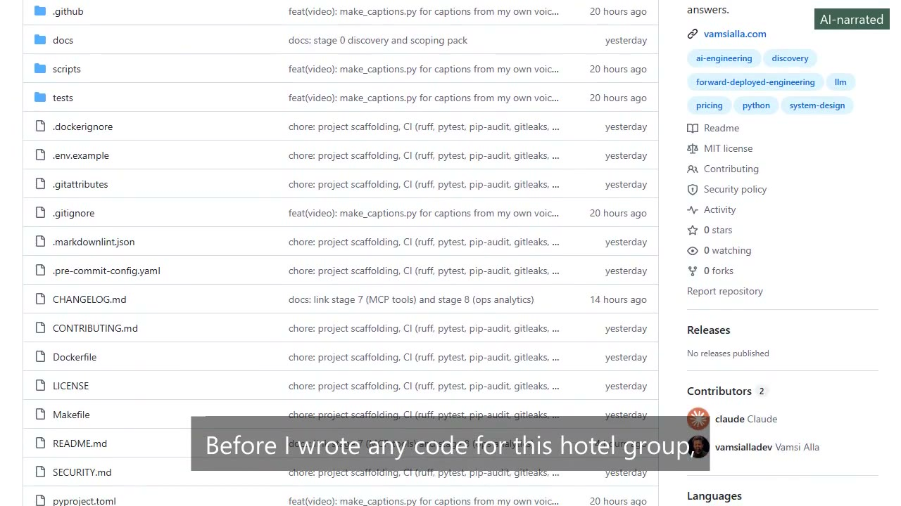
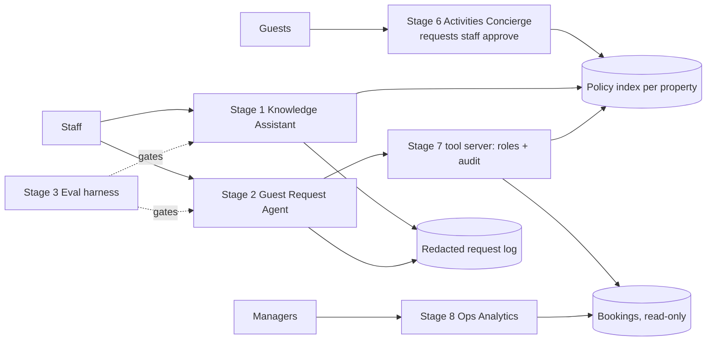
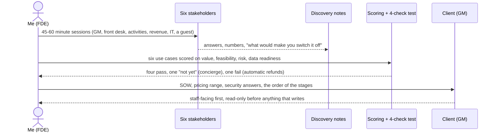

# Hotel AI Discovery & Scoping Pack

[](https://github.com/vamsialladev/hotel-ai-discovery/actions/workflows/ci.yml)

[](https://docs.astral.sh/ruff/)
[](LICENSE)

**Stage 0 of a hotel-group AI engagement: the discovery, problem selection, scope, pricing and security answers
that came before any code.**

> **Simulated client engagement.** The hotel group (Beach Resort, Mountain Lodge), its people and every answer are
> fictional, and all data is synthetic. Stage 0 is written up after stages 1–5 were built, so it explains their
> order rather than predicting it.

<!-- DEMO-VIDEO -->
<!-- AI-NARRATED-DEMO:START -->
<a href="https://vamsialla.com/projects/hotel-ai-discovery.html#demo"></a>

**Demo video (1:20, AI-narrated):** [watch it with sound on vamsialla.com](https://vamsialla.com/projects/hotel-ai-discovery.html#demo) (GitHub can't play MP4 files from a repo) · [download the MP4](docs/video/demo-ai-voice.mp4) · captions burned in ([text](docs/video/demo-ai-voice.srt)). The narrator is an AI voice (Kokoro); my own-voice version will replace it.
<!-- AI-NARRATED-DEMO:END -->

**Try it live:** there's no app for this stage. Start with the document map below, or run the pricing script.

## At a glance

| | |
|---|---|
| **Problem** | A hotel group wants AI help at the front desk but hasn't agreed what to build first, what it may touch, or what it should cost |
| **Solution** | A discovery pack: six stakeholder sessions, six use cases scored with a 4-check test, SOW, pricing model, architecture, security questionnaire, risk register |
| **Measured quality** | Not an AI feature, so no eval. Pricing tables are generated by a tested script; CI fails if docs and script disagree |
| **Cost** | Model cost inputs are measured in later stages: $0.18 per 1,000 questions (stage 1), $1.24 per 1,000 emails (stage 2) |

## Document map

| Read this | If you want | File |
|---|---|---|
| Discovery session | The questions I asked six stakeholders and what they said | [docs/DISCOVERY.md](docs/DISCOVERY.md) |
| Problem selection | Six use cases scored, the 4-check test, and the build order | [docs/PROBLEM_SELECTION.md](docs/PROBLEM_SELECTION.md) |
| Statement of work | Scope, deliverables, acceptance criteria, change control | [docs/SOW.md](docs/SOW.md) |
| Pricing | Build and run cost, three pricing options, three scenarios | [docs/PRICING.md](docs/PRICING.md) |
| Architecture proposal | Target design, model choice, PII, scale path, failure modes | [docs/ARCHITECTURE_PROPOSAL.md](docs/ARCHITECTURE_PROPOSAL.md) |
| Security questionnaire | Answers to a typical procurement questionnaire | [docs/SECURITY_QUESTIONNAIRE.md](docs/SECURITY_QUESTIONNAIRE.md) |
| Risk register | Risk, likelihood, impact, owner, mitigation | [docs/RISKS.md](docs/RISKS.md) |
| Interview walkthrough | How I'd present this in a 60-minute FDE design round | [docs/INTERVIEW_WALKTHROUGH.md](docs/INTERVIEW_WALKTHROUGH.md) |
| Agent protocols | Which protocol each connection uses, and how I'd choose for a new one | [docs/PROTOCOLS.md](docs/PROTOCOLS.md) |
| Decisions | Why the pack is built this way | [docs/DECISIONS.md](docs/DECISIONS.md) |
| This repo's architecture | How the scripts and checks fit together | [docs/ARCHITECTURE.md](docs/ARCHITECTURE.md) |
| Video script | The 75-second walkthrough I record | [docs/VIDEO_SCRIPT.md](docs/VIDEO_SCRIPT.md) |

## Where to start

| You are | Read |
|---|---|
| A recruiter (2 minutes) | At a glance, then [PROBLEM_SELECTION.md](docs/PROBLEM_SELECTION.md) |
| A hotel manager | [DISCOVERY.md](docs/DISCOVERY.md), [SOW.md](docs/SOW.md), [PRICING.md](docs/PRICING.md) |
| An engineer | [ARCHITECTURE_PROPOSAL.md](docs/ARCHITECTURE_PROPOSAL.md), [SECURITY_QUESTIONNAIRE.md](docs/SECURITY_QUESTIONNAIRE.md), `scripts/` |

## The problem

A guest at Mountain Lodge asks about early check-in. The fee isn't in the policy; it's in staff notes. The
front-desk lead radios the night manager and the guest waits four minutes. Across both properties that happens a
few times an hour, staff give different answers on different shifts, and about once a week a wrong answer ends in
a credit. The GM wants help but is clear about one thing: one confident wrong answer about money reaching a guest,
and it gets switched off.

## What it does

1. **Discovery:** 10–15 questions per stakeholder (GM, front-desk lead, activities manager, revenue manager,
   IT/security, a guest), ending in users, success metrics, data sensitivity, constraints and open questions.
2. **Problem selection:** six use cases scored on value, feasibility, risk and data readiness, then a 4-check test
   (felt the problem / someone pays / V1 in a week / first customer known).
3. **Scope and price:** a SOW with acceptance criteria per stage, and a pricing model that separates the one
   measured input (model cost) from the assumptions.
4. **Security and risk:** answers to a procurement questionnaire and a risk register, each pointing at what the
   later stages actually built.

## Architecture

The proposed system (full version in [ARCHITECTURE_PROPOSAL.md](docs/ARCHITECTURE_PROPOSAL.md)):



How the discovery itself ran, start to finish:



## Results

There's no model in this repo, so nothing here is an eval score.

| Check | Result |
|---|---|
| Use cases passing the 4-check test | 4 of 6 (one "not yet", one fail: automatic refunds) |
| Pricing doc in sync with the script | Checked by a test on every push |
| Placeholders and broken local links | Checked by `scripts/check_docs.py` on every push |

### Business value (projection)

- **Who benefits:** front-desk and reservations staff (time), the GM (fewer wrong-answer credits), the client's
  IT team (a security questionnaire answered before the pilot).
- **Time or money:** the stage 1 and stage 2 business cases project about $69,000 a year net for two properties
  in the base case. Those are projections, not results.
- **How a pilot would measure it:** the success metrics table in [DISCOVERY.md](docs/DISCOVERY.md) (accuracy,
  escalation recall, time to answer, adoption, complaint count), with go / no-go targets.

Base-case price (projection, 2 properties): fixed-fee pilot $22,000, then $460 per property per month. Full
range in [PRICING.md](docs/PRICING.md).

## Design at scale

| Point | Summary (details in [ARCHITECTURE_PROPOSAL.md](docs/ARCHITECTURE_PROPOSAL.md)) |
|---|---|
| Model choice | Claude Haiku 5.5: matched Haiku 4.5 within run-to-run range in stage 1 at about a fifth of the cost |
| PII and tenant isolation | Send only what's needed; redact before writing; property as a filter; `hotel_group_id` on every record in the tool server |
| 10K → 1M users | Free hosting sleeps first, then the per-app index, then the shared budget, then model rate limits at peaks |
| Monitoring and hallucinations | Grounding check per answer, request log with cost and latency, daily health check, eval gates; LLM judge not trusted yet |
| Failure modes and rollback | Timeout + retry + fallback, kill switch, redeploy the previous tag, budgets and caps |

## The engagement

| Stage | Repo | What |
|---|---|---|
| 0 | this repo | Discovery & scoping |
| 1 | [hotel-ops-assistant](https://github.com/vamsialladev/hotel-ops-assistant) | Knowledge Assistant (RAG with citations) |
| 2 | [guest-request-agent](https://github.com/vamsialladev/guest-request-agent) | Guest Request Agent (tools, staff approval) |
| 3 | [eval-harness](https://github.com/vamsialladev/eval-harness) | Eval harness and CI gates for stages 1–2 |
| 4 | [hotel-ops-assistant v1.6.0](https://github.com/vamsialladev/hotel-ops-assistant/releases) and [guest-request-agent v1.1.0](https://github.com/vamsialladev/guest-request-agent/releases) | Production: eval-found fixes, redacted logs, staff role, kill switch |
| 5 | [hotel-ai-handoff](https://github.com/vamsialladev/hotel-ai-handoff) | Client handoff: runbooks, SLOs, guides |
| 7 | [hotel-tools-mcp](https://github.com/vamsialladev/hotel-tools-mcp) | The group's tools for any MCP client, with roles, tenant isolation and an audit log |
| 8 | [hotel-ops-analytics-agent](https://github.com/vamsialladev/hotel-ops-analytics-agent) | Plain-English questions over the bookings database (SQL always shown) and a daily anomaly check |

## Run locally

Windows (PowerShell):

```powershell
git clone https://github.com/vamsialladev/hotel-ai-discovery.git
cd hotel-ai-discovery
py -3.12 -m venv .venv
.venv\Scripts\Activate.ps1
pip install -r requirements-dev.txt
python scripts/pricing.py --scenarios
python -m pytest
```

macOS / Linux:

```bash
git clone https://github.com/vamsialladev/hotel-ai-discovery.git
cd hotel-ai-discovery
python3.12 -m venv .venv && source .venv/bin/activate
pip install -r requirements-dev.txt
python scripts/pricing.py --scenarios
python -m pytest
```

Docker:

```bash
docker build -t hotel-ai-discovery .
docker run --rm hotel-ai-discovery
```

## Limitations and roadmap

- The answers are simulated. A real engagement would replace them with notes from real sessions.
- Written after stages 1–5, so the selection explains an order that was already built.
- Pricing assumptions (support hours, rate, hosting) are not measured; a pilot's time log and invoices would
  replace them.
- Roadmap: SSO, region pinning and a third-party pen test are marked as such in the security answers.

## Skills demonstrated

| FDE skill | Where it shows |
|---|---|
| Discovery with non-technical stakeholders | [DISCOVERY.md](docs/DISCOVERY.md) |
| Choosing what to build first | [PROBLEM_SELECTION.md](docs/PROBLEM_SELECTION.md) |
| Scoping and acceptance criteria | [SOW.md](docs/SOW.md) |
| Pricing from measured costs | [PRICING.md](docs/PRICING.md), `scripts/pricing.py` |
| System design at scale | [ARCHITECTURE_PROPOSAL.md](docs/ARCHITECTURE_PROPOSAL.md) |
| Security and procurement | [SECURITY_QUESTIONNAIRE.md](docs/SECURITY_QUESTIONNAIRE.md), [SECURITY.md](SECURITY.md) |
| Risk management | [RISKS.md](docs/RISKS.md) |
| Explaining a design out loud | [INTERVIEW_WALKTHROUGH.md](docs/INTERVIEW_WALKTHROUGH.md) |

## Commands

| Command | What it does |
|---|---|
| `python scripts/pricing.py` | Base case, 2 properties |
| `python scripts/pricing.py --scenarios --properties 100` | Pessimistic / base / optimistic for 100 properties |
| `python scripts/pricing.py --write-docs` | Refresh the tables in `docs/PRICING.md` |
| `python scripts/check_docs.py` | Required docs, README links, placeholders, local links |
| `make check` | Lint, format check, tests, doc checks |

## Configuration

None. The scripts read no environment variables and call no API. `.env.example` is kept for consistency with the
other stages and is empty.

## Testing and quality

`python -m pytest` runs the unit tests for both scripts with a 90% coverage gate. CI also runs ruff (lint +
format), pip-audit, gitleaks, markdownlint and a lychee link check.

## Security

See [SECURITY.md](SECURITY.md) (threat model and OWASP LLM Top 10 mapping for the proposed system).

## Author

Vamsi Alla · [vamsialla.com](https://vamsialla.com) · [LinkedIn](https://www.linkedin.com/in/vamsi-alla/) ·
[GitHub](https://github.com/vamsialladev)

## License

[MIT](LICENSE)
