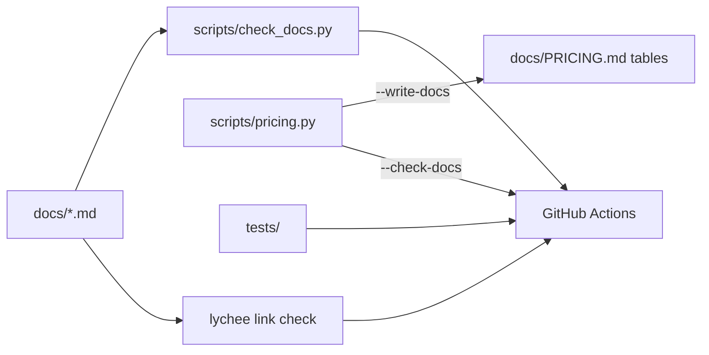

# Architecture (this repo)

This repo is documents plus two small scripts. The system it proposes is in
[ARCHITECTURE_PROPOSAL.md](ARCHITECTURE_PROPOSAL.md).

| Component | Job |
|---|---|
| `scripts/pricing.py` | Pure functions for build cost, run cost and three pricing options; `--scenarios`; writes and checks the tables in `docs/PRICING.md` |
| `scripts/check_docs.py` | Required documents exist, the README links each one, no placeholders, no broken local links |
| `tests/` | Unit tests for both scripts, including "the pricing doc matches the script" |
| CI | ruff lint + format, pytest with a 90% coverage gate, pip-audit, gitleaks, markdownlint, lychee |
