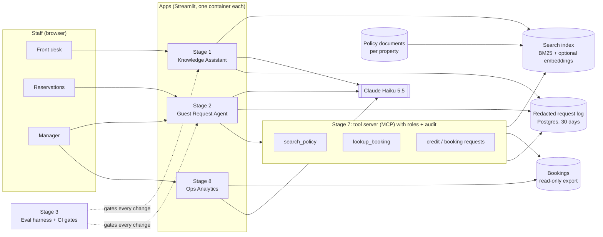

# Architecture proposal

> Simulated client engagement with synthetic data. This is the target design I proposed after discovery. Parts
> marked **Roadmap** were not built in the published stages.

## Target architecture

**Request flow (guest email):** email arrives → booking looked up by sender (deterministic, before the model) →
policy passages retrieved for the booking's property → model drafts a reply and proposes tasks → anything with
money or guest impact is marked "needs manager approval" → a person edits and sends → the request is logged after
redaction.

## Model choice

| Option | Why / why not |
|---|---|
| **Claude Haiku 5.5 (default)** | Measured in stage 1: 97% hybrid answer accuracy at $0.19 per 1,000, vs. Haiku 4.5 at 98% for $0.99 per 1,000 — within run-to-run range for about a fifth of the cost. |
| Larger model | Kept for hard cases only if the eval shows a gap the small model can't close. Not needed in stages 1–2. |
| Self-hosted open model | Only if data residency rules forbid any external API. Adds hosting and eval work. |

Every model change goes through the eval harness first (stage 3).

## PII and tenant isolation

- **Send the model only what it needs:** the question and retrieved passages; for emails, the email text and the
  booking fields the reply uses. No raw conversation history, no full guest profile.
- **Redact before writing:** names, emails, phones and card numbers replaced; booking IDs hashed, before any log
  write.
- **Property is a filter, not a hint:** every passage carries its property; retrieval filters on it.
- **Tenant isolation (Roadmap for more than one group):** a `hotel_group_id` on every record and every query,
  enforced in the tool server (stage 7), with tests that prove no cross-tenant reads.
- **Bookings are read-only** and looked up by sender, so one guest can't read another's booking.

## Scale path: 10K → 1M guests

| Scale | What breaks first | The fix |
|---|---|---|
| 2 properties, ~10K guests/year | Nothing; free hosting sleeps after idle | Keep-awake ping; always-on container for the pilot |
| ~50 properties, ~250K guests | One in-memory index per app; app restarts reload documents | Index built once in CI, stored with a fingerprint; apps load it read-only |
| ~100 properties | Request log on one small database; per-session caps don't protect a shared budget | Managed Postgres with retention jobs; per-property daily budgets; queue for email drafting |
| ~1M guests/year | Model rate limits during check-in peaks; single region | Request queue with back-off, prompt caching, a second region, provider rate-limit increase |

## Monitoring and catching hallucinations

- **Every answer is checked before display:** cited passage exists, numbers in the answer appear in the passages
  (numeric grounding), manager rules quoted from the documents.
- **Request log** with outcome, citations, tokens, cost and latency per request; Operations page for the owner.
- **Daily health check** opens an issue when an app is down or errors exceed 20% in 24 hours (stage 5).
- **Eval re-runs** on every change and before every release; regressions fail CI.
- **Off-brand detection (Roadmap):** an LLM judge only after it agrees with human labels; stage 3 showed it
  doesn't yet (kappa 0.29), so nothing is gated on it.

## Failure modes and rollback

| Failure | What the user sees | Recovery |
|---|---|---|
| Model API down or slow | A safe error message; no half answer | 30 s timeout + retry; deterministic fallback reply in stage 2 |
| Wrong answer reaches staff | Citation shows the source; staff flag it | Thumbs-down logged; eval case added; fix gated by CI |
| Prompt injection in an email | Draft ignores the instruction; planted text quarantined | Injection cases in the eval are hard gates (100%) |
| Bad deploy | App errors | Kill switch setting; redeploy the previous tag |
| Cost spike | Session or daily cap message | Budgets in CI; provider spending limit |
